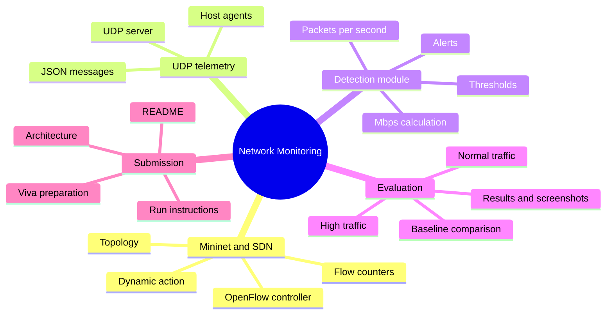

# Integration contract for team members

This document defines how the detection module can connect to the UDP server and SDN controller.

## 1. Ownership

- **Member 1:** Mininet topology, controller, OpenFlow connection, flow-statistics retrieval and any dynamic SDN action.
- **Member 2:** UDP telemetry agent/server and message decoding.
- **Member 3:** `monitoring/detector.py`, threshold logic, tests and performance-analysis support.
- **Member 4:** Integrates modules, maintains the main run procedure and final repository documentation.

## 2. Controller → detector

The controller adapter should supply a dictionary with these fields:

| Field | Type | Required |
|---|---|---|
| `switch` | string | Yes |
| `flow_id` | string | Yes |
| `byte_count` | non-negative integer | Yes |
| `packet_count` | non-negative integer | Recommended |
| `timestamp` | Unix timestamp in seconds | Recommended |

Call:

```python
result = detector.process_flow_stats(flow_sample)
```

The controller's counters are cumulative. Do not pass interval deltas as `byte_count` or the detector will calculate an incorrect rate.

## 3. UDP server → detector

After decoding a valid UDP JSON message, the server may call:

```python
result = detector.process_telemetry(message)
```

Expected keys: `host`, `timestamp`, `bytes_sent`, and `packets_sent`. The two count fields are optional, but the host identifier should be included.

## 4. Alert handling

Each returned alert is a dictionary containing:
- `severity`
- `source`
- `metric`
- `value`
- `threshold`
- `message`
- `timestamp`

The integration layer should log/display these alerts. It should not silently assume that an alert has changed network behavior.

## 5. Integration test sequence

1. Start the controller and Mininet topology in Ubuntu.
2. Confirm switch connection and host reachability.
3. Start the UDP server and agents.
4. Verify the server receives messages from multiple hosts.
5. Collect two or more flow-statistics samples for the same flow.
6. Confirm Mbps is calculated from the change in byte counter over elapsed time.
7. Generate normal traffic and record output.
8. Generate a higher traffic rate and confirm the configured threshold alert.
9. Demonstrate any controller-side action separately and verify its effect.
10. Save real outputs and measurements for the final report.

## 6. Mermaid mind map


